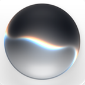

# Loon 自定义图标

## Siri



- 文件：`siri.png`
- 格式：PNG
- 尺寸：`144×144`
- 色彩：RGBA
- 完整保留原始白色圆角矩形背景和中央 Siri 球

在 Loon 策略组中使用：

```text
img-url = https://raw.githubusercontent.com/GoldenLoaf24h/goldenloafs-loon/main/icons/siri.png
```
